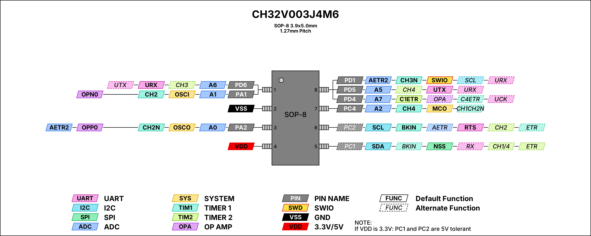

# CH32V003J4M6-Dev-Board
A breakout for the 8-pin RISC-V MCU that costs less than the coffee you’ll drink debugging it. USB-C power, SWIO programming, breadboard friendly.

It breaks out all MCU pins for maximum flexibility, while keeping a minimal footprint.

An onboard debug / status **LED on PC4** can be enabled or completely disconnected via a solder jumper, giving you full control over pin usage.
Programming is straightforward thanks to the dedicated 3-pin SWIO header, making it fully compatible with standard WCH debugging tools.

Also includes a TVS diode for input protection, and convenient power is provided through a 6-pin USB-C connector, ensuring easy integration into modern setups.
Ideal for breadboard experimentation, small projects, or as a compact development platform for the CH32V003 series.

 

## Pinout

<picture>
  <source media="(prefers-color-scheme: dark)" srcset="Img/CH32V003J4M6_pinout_dark.png">
  <source media="(prefers-color-scheme: light)" srcset="Img/CH32V003J4M6_pinout.png">
  
</picture>

Solid labels are default functions, dashed labels are alternate (remapped) functions. Pin 1 is shared by PA1 and PD6, and pin 8 by PD1 (SWIO), PD4 and PD5. Vector versions: [light](Img/CH32V003J4M6_pinout.svg) · [dark](Img/CH32V003J4M6_pinout_dark.svg).

## Programming

**To program this board, you will need a WCH-LinkE programmer. Be sure you buy the correct one (with the letter "E" at the end)**

The board can be programmed via MountRiver Studio or via the Arduino IDE using the official WCH core:
(https://github.com/openwch/ch32v003)

You will also have to install the drivers that can be found here https://github.com/openwch/ch32v003/tree/main/WCH-LinkUtility/Drv_Link

**Also don't forget, before connecting the programmer to your PC, make sure to press the MODE_S button on the WCH-LinkE to switch it into the correct mode (the one where the blue LED is off).**

## If you want to edit the PCB
 
**Project can also be found here:** [https://oshwlab.com/mariusmym/attiny1616_vcnl4200_rgb_controller](https://oshwlab.com/mariusmym/ch32v0033j4m6-dev-board)

## License 

This project is licensed under [Creative Commons Attribution-ShareAlike 4.0 International](https://creativecommons.org/licenses/by-sa/4.0/).

- ✅ **Share** – copy and redistribute it in any medium or format
- ✅ **Adapt** – remix, transform, and build upon it
- 🏷️ **Attribution** – give credit and link back here
- 🔁 **ShareAlike** – if you remix it, share your version under the same license

Have fun !
